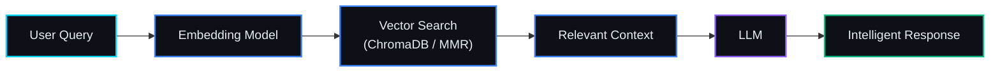
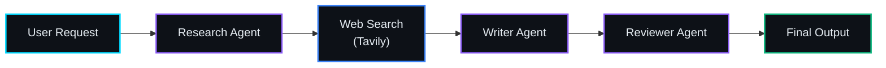

<div align="center">

<!-- HERO BANNER -->


<!-- TYPING SVG -->
<a href="https://github.com/AmanNishad-ic">
  
</a>

<br />

**Engineering Intelligence. Building Autonomous Systems. Transforming Ideas into AI Solutions.**

<br />

<!-- QUICK ACTION BADGES -->
<a href="https://amannishad-ic.github.io/aman-portfolio/">
  
</a>
<a href="https://www.linkedin.com/in/aman-nishad-6a0439414/">
  
</a>
<a href="https://github.com/AmanNishad-ic">
  
</a>
<a href="mailto:amannishad.ic@gmail.com">
  
</a>


</div>

<br />

## About Me

I am an **AI Engineer** at **Swenta Solutions** based in **Mumbai, India**, focused on building practical AI-powered applications across **Generative AI**, **Agentic AI**, and **Machine Learning**.

My engineering work centers on **Large Language Models (LLMs)**, **Retrieval-Augmented Generation (RAG)**, **Multi-Agent Systems**, **AI Automation**, and **intelligent backend applications**, backed by a foundation in **Data Science and Analytics**. I focus on designing reliable, structured workflows that turn raw data and language models into usable software systems.

<br />

## Developer Identity

```python
class AIEngineer:
    def __init__(self):
        self.name = "Aman Nishad"
        self.username = "AmanNishad-ic"
        self.role = "AI Engineer @ Swenta Solutions"
        self.location = "Mumbai, India"
        self.languages = ["Python", "SQL"]
        self.core_domains = [
            "Generative AI & LLMs",
            "Agentic AI & Multi-Agent Systems",
            "Retrieval-Augmented Generation (RAG)",
            "Machine Learning & Data Pipelines",
        ]

    def mission(self) -> str:
        return "Build intelligent systems that solve real-world problems."


aman = AIEngineer()
```

<br />

## Featured AI Engineering Projects

<table>
  <tr>
    <td width="50%" valign="top">
      <h3>ResearchMind AI — Multi-Agent Research Assistant</h3>
      <p>
        <strong>Overview:</strong> A multi-agent AI research assistant that automates end-to-end web research and structured report synthesis.<br />
        <strong>Problem Solved:</strong> Eliminates manual multi-tab research, content extraction, and iterative drafting by coordinating specialized AI agents.<br />
        <strong>Key Features:</strong>
      </p>
      <ul>
        <li>Multi-agent AI research workflows</li>
        <li>Automated web searching via Tavily integration</li>
        <li>Webpage content extraction and parsing</li>
        <li>AI-powered content generation and automated reviewing</li>
        <li>Structured research report generation</li>
      </ul>
      <p>
        
        
        
        
      </p>
      <p>
        <a href="https://github.com/AmanNishad-ic/researchmind-ai">
          
        </a>
      </p>
    </td>
    <td width="50%" valign="top">
      <h3>RAG-Based Document Question Answering System</h3>
      <p>
        <strong>Overview:</strong> A Retrieval-Augmented Generation application for querying PDF documents with grounded, context-aware responses.<br />
        <strong>Problem Solved:</strong> Reduces LLM hallucinations on private or long documents by retrieving relevant semantic chunks before generation.<br />
        <strong>Key Features:</strong>
      </p>
      <ul>
        <li>PDF document processing and text chunking</li>
        <li>Dense embedding generation and ChromaDB vector storage</li>
        <li>Semantic search and Maximal Marginal Relevance (MMR) retrieval</li>
        <li>Context-aware AI responses powered by Mistral AI</li>
      </ul>
      <p>
        
        
        
        
        
      </p>
      <p>
        <a href="https://github.com/AmanNishad-ic/agentic-ai">
          
        </a>
      </p>
    </td>
  </tr>
  <tr>
    <td width="50%" valign="top">
      <h3>MLOps-Style Batch Processing Pipeline</h3>
      <p>
        <strong>Overview:</strong> An end-to-end, containerized batch data processing pipeline driven by declarative YAML configuration.<br />
        <strong>Problem Solved:</strong> Standardizes repeatable data preparation with automated validation, structured logging, and reproducible execution.<br />
        <strong>Key Features:</strong>
      </p>
      <ul>
        <li>Automated data ingestion, cleaning, and transformation</li>
        <li>Schema and data validation checks</li>
        <li>YAML-based configuration management</li>
        <li>Structured logging, error handling, and metrics tracking</li>
        <li>Docker containerization for portable execution</li>
      </ul>
      <p>
        
        
        
        
        
        
      </p>
      <p>
        <a href="https://github.com/AmanNishad-ic/mlops_batch_job-">
          
        </a>
      </p>
    </td>
    <td width="50%" valign="top">
      <h3>Car Price Prediction — Machine Learning</h3>
      <p>
        <strong>Overview:</strong> A supervised Machine Learning regression pipeline for predicting vehicle prices from structured features.<br />
        <strong>Problem Solved:</strong> Estimates vehicle valuation using engineered tabular features and encoded categorical attributes.<br />
        <strong>Key Features &amp; Verified Metrics:</strong>
      </p>
      <ul>
        <li>Data preprocessing, feature engineering, and categorical encoding</li>
        <li>Linear Regression model training and evaluation</li>
        <li><strong>R² Score:</strong> 0.8045 &nbsp;|&nbsp; <strong>MAE:</strong> 0.2596 &nbsp;|&nbsp; <strong>RMSE:</strong> 0.3502</li>
      </ul>
      <p>
        
        
        
        
      </p>
      <p>
        <em>Verified ML Case Study (Resume &amp; Portfolio)</em>
      </p>
    </td>
  </tr>
</table>

<br />

## AI System Architecture

> *Note: The diagrams below are illustrative reference architectures demonstrating how I design RAG and multi-agent systems, distinct from individual repository implementations.*

### Illustrative RAG Workflow



### Illustrative Multi-Agent Research Workflow



<br />

## Technical Arsenal

### Programming & Backend Engineering
<p>
  
  
  
  
  
</p>

### Generative AI & Agentic AI
<p>
  
  
  
  
  
  
  
  
  
  
</p>

### Vector Search & Knowledge Retrieval
<p>
  
  
  
  
  
  
</p>

### Machine Learning
<p>
  
  
  
  
  
  
  
</p>

### Data Science & Analytics
<p>
  
  
  
  
  
  
  
</p>

### Developer Tools & MLOps
<p>
  
  
  
  
</p>

<br />

## Professional Experience

**AI Engineer — Swenta Solutions** (`July 2026 – Present`)
- Applying Python and AI development skills to practical engineering tasks.
- Contributing to AI-related development and technical problem-solving in production-oriented workflows.

**Education:** B.Sc. in Biotechnology — Elphinstone College, Mumbai (`2026`)

<br />

## Current Focus & Learning

Areas I am actively exploring and deepening through hands-on experimentation:

- **Advanced Agentic AI Systems & Multi-Agent Orchestration** — stateful tool use, planning loops, and agent coordination
- **Intelligent RAG Architectures** — retrieval quality tuning, chunking strategies, and hybrid/MMR ranking
- **LLM-Powered Applications & AI Automation** — reliable structured outputs and workflow automation
- **Machine Learning Engineering & AI Backend Development** — serving models and LLM pipelines with FastAPI
- **MLOps Fundamentals** — reproducible batch pipelines, containerization, and configuration-driven workflows

<br />

## GitHub Analytics Dashboard

<div align="center">


<br />


<br />


</div>

<br />

## Contribution Snake

<div align="center">
  <picture>
    <source media="(prefers-color-scheme: dark)" srcset="https://raw.githubusercontent.com/AmanNishad-ic/AmanNishad-ic/output/github-contribution-grid-snake-dark.svg" />
    <source media="(prefers-color-scheme: light)" srcset="https://raw.githubusercontent.com/AmanNishad-ic/AmanNishad-ic/output/github-contribution-grid-snake.svg" />
    
  </picture>
</div>

<br />

## Let's Connect

<div align="center">

I'm always interested in collaborating on intelligent AI applications, innovative machine learning projects, and emerging Generative AI technologies.

**Let's build something intelligent together.**

<br />

<a href="https://amannishad-ic.github.io/aman-portfolio/">
  
</a>
<a href="https://www.linkedin.com/in/aman-nishad-6a0439414/">
  
</a>
<a href="https://github.com/AmanNishad-ic">
  
</a>
<a href="mailto:amannishad.ic@gmail.com">
  
</a>

</div>

<br />


